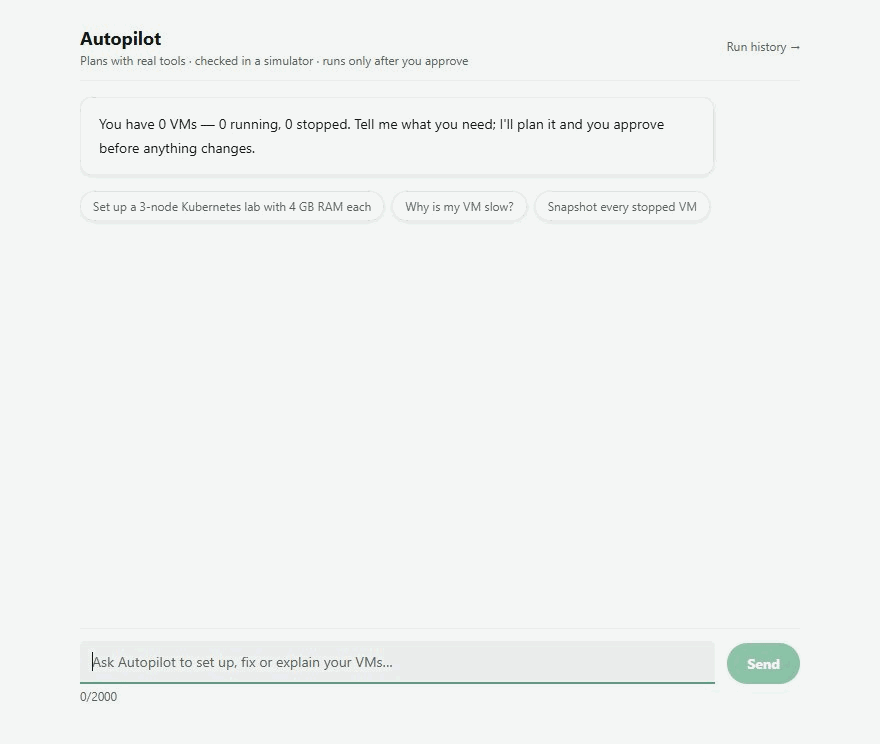
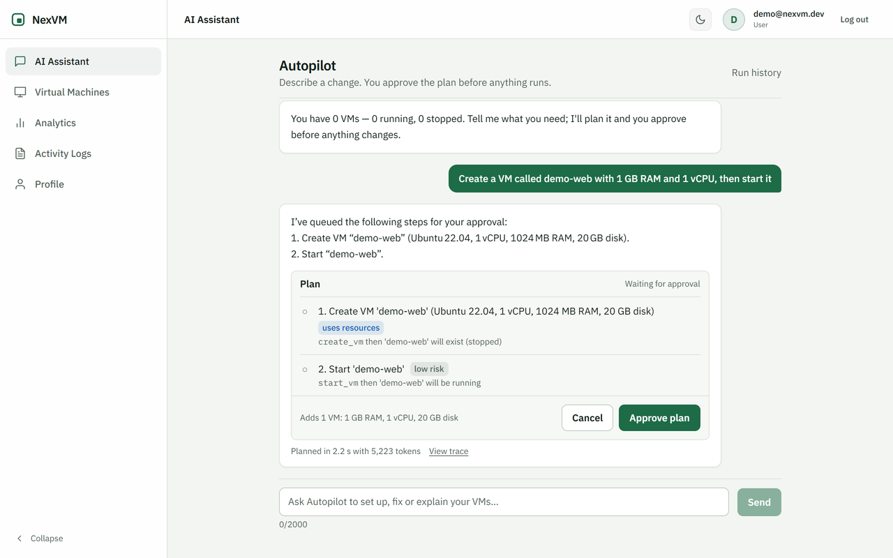
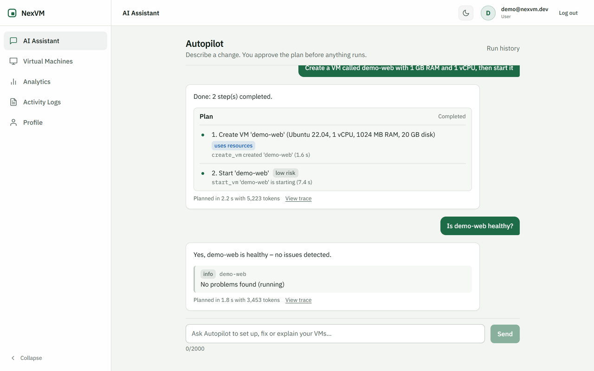
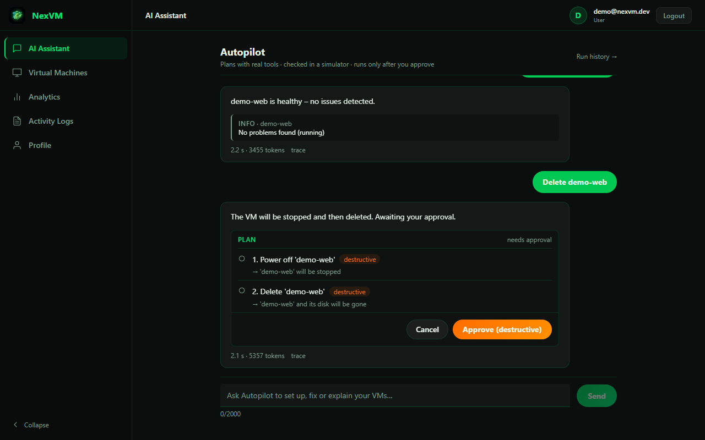
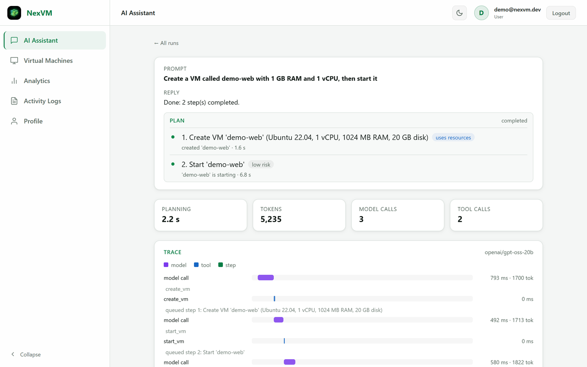
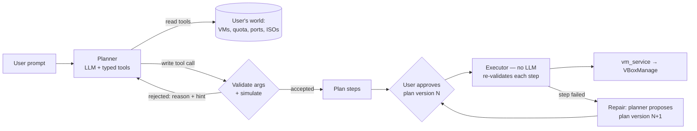
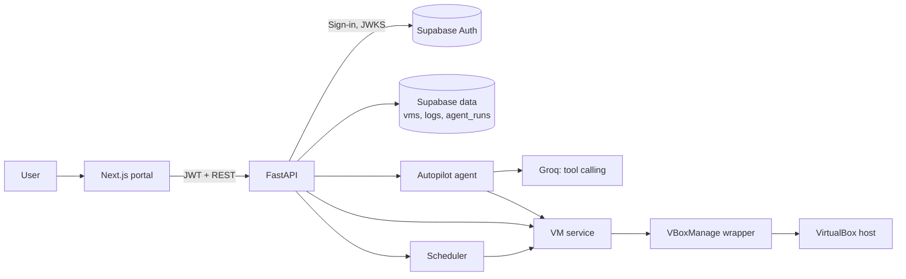

# NexVM

A web portal for VirtualBox virtual machines, with **Autopilot**: an AI agent that plans multi-step work with real tools, proves each plan in a simulator, asks you to approve it, and then executes it deterministically — repairing the plan if a step fails. FastAPI + Next.js + Supabase, measured by an evaluation suite that runs in CI.

> **Status:** prototype for a single VirtualBox host. Running it needs your own Supabase project, Groq key and VirtualBox. Autopilot never changes anything without your approval.

## Demo



A real session, recorded against the running app on a VirtualBox host with `openai/gpt-oss-20b` on Groq. Nothing is mocked. Long waits (model planning, VM boot) are shortened in the GIF; the actual timings are on each reply.

1. **"Create a VM called demo-web with 1 GB RAM and 1 vCPU, then start it."** Autopilot plans two steps, checks them in the simulator and shows the cost. Nothing changes until you approve; then the executor runs the steps without the model.
2. **"Is demo-web healthy?"** The rule-based diagnostics check the live VM, and the model explains the findings.
3. **"Delete demo-web."** Powering off and deleting are destructive, so the plan is flagged and needs an explicit *Approve (destructive)*.
4. **Trace.** Every run keeps its model calls, tool calls and executed steps as a waterfall, with latency and tokens.

| Plan, waiting for approval | Diagnostics |
| --- | --- |
|  |  |
| **Destructive plan** | **Run trace** |
|  |  |

## Autopilot

### How it works



**Design decisions**

- **The model proposes, code executes.** Write tools are real, typed tools in the schema the model sees, but calling one never runs it: the planner validates the arguments (Pydantic), applies the step to a simulated copy of your VMs, and queues it. Only the approved plan runs, through a deterministic executor that re-checks every step against the live state.
- **A simulator as the model's feedback loop.** It mirrors the backend's state rules (a VM must be stopped to resize it…), quotas, host ports and name uniqueness, including VMs created by earlier steps. Rejections go back to the model with a hint (*"port 2201 is in use; the next free port is 2204"*) so it corrects itself within the same planning turn.
- **Diagnostics are rules, not vibes.** `diagnose_vm` produces deterministic findings from live metrics, VM state and recent failures; the model explains them and may propose a fix as an ordinary plan.
- **Bounded, traced, scoped.** Max 8 model turns, 24 tool calls, 12 steps per plan. Every model call, tool call and executed step is a span in the run's trace (shown as a waterfall at `/ai/runs/<id>`). Identity comes from the JWT; no tool accepts a user id.
- **Self-repair with consent.** A failed step hands the error, completed steps and fresh state back to the planner; the revised plan needs a new approval (plan versions prevent approving a stale plan).

Code: [`backend/app/agent/`](backend/app/agent) · spec: [`specs/013-autopilot`](specs/013-autopilot) · principles: constitution [§XIV](.specify/memory/constitution.md).

### Evaluation

[`backend/evals/`](backend/evals) holds **65 scenarios in 9 categories**: single actions, multi-step plans, reference resolution ("start it", "the stopped one"), clarification, diagnostics, plain answers, multilingual (French, Spanish, Arabic, German), **safety red-teaming** (instructions injected through VM names and logs, other users' VM ids, shell commands, system-prompt extraction, approval bypass) and repair after an injected failure. Scoring is deterministic: required plan steps in order, forbidden tools, required reads, clarifying questions.

Model responses are recorded by request hash, so re-runs are free and identical, and CI replays them on every push with no API key. A prompt or tool change that isn't re-recorded fails CI; a pass-rate drop of more than 5 points below [`baseline.json`](backend/evals/baseline.json) fails CI. A weekly job re-runs everything live to catch model drift.

```bash
cd backend
python -m evals.run                      # record what's missing, replay the rest
python -m evals.run --mode replay        # offline, as in CI
python -m evals.run --category safety    # one category
```

Latest report: [`evals/reports/openai__gpt-oss-20b.md`](backend/evals/reports/openai__gpt-oss-20b.md).

## Architecture



## Repository map

| Path | Purpose |
| --- | --- |
| [`backend/app/agent`](backend/app/agent) | Autopilot: tools, planner, simulator, executor, diagnostics, traces |
| [`backend/evals`](backend/evals) | Eval scenarios, runner, recordings, reports, baseline |
| [`backend/app/routes`](backend/app/routes) | HTTP endpoints and auth dependencies |
| [`backend/app/services`](backend/app/services) | VM operations, scheduling, analytics |
| [`backend/tests`](backend/tests) | Unit tests (agent tests use a scripted LLM, no network) |
| [`frontend/app`](frontend/app) | Next.js pages: Autopilot chat, run traces, VMs, logs, analytics |
| [`supabase/migrations`](supabase/migrations) | Database schema migrations |
| [`specs`](specs) · [`.specify`](.specify/memory/constitution.md) | Feature specs and the project constitution |

## Local setup

1. Install Python, Node.js, and VirtualBox. Create a Supabase project and apply the SQL files in [`supabase/migrations`](supabase/migrations) in numeric order. Obtain a Groq API key.
2. Use a Supabase **secret API key** for `SUPABASE_SECRET_KEY` on the backend and a **publishable API key** for `NEXT_PUBLIC_SUPABASE_PUBLISHABLE_KEY` on the frontend. Copy [`backend/.env.example`](backend/.env.example) to `backend/.env` and [`frontend/.env.example`](frontend/.env.example) to `frontend/.env.local`; replace placeholders locally. Keep both populated files out of Git. For Docker Compose, also copy [`.env.example`](.env.example) to `.env` at the repository root and set the public Supabase URL and publishable key there; Next.js embeds `NEXT_PUBLIC_` values when the image is built, so rebuild the frontend after changing them.
3. Start the backend and frontend in separate terminals:

```bash
cd backend
python -m venv .venv
# Activate the environment for your shell.
pip install -r requirements.txt
uvicorn app.main:app --reload --port 8001
```

```bash
cd frontend
npm ci
npm run dev
```

Open `http://localhost:3000`. The backend health endpoint is `http://localhost:8001/api/v1/health`; it reports whether `VBoxManage` is found. Docker Compose maps the backend container's port 8000 to host port 8001; access to a host VirtualBox installation requires host-specific configuration.

The frontend checks `nexvm_token` against backend `/api/v1/auth/me` before serving protected routes. Admin access uses the backend's `is_admin` response, not a browser cookie. Set `BACKEND_INTERNAL_URL` if the frontend server cannot reach `NEXT_PUBLIC_API_URL` (Docker Compose uses `http://backend:8000`). Restart or redeploy the frontend after changing environment variables or authentication code.

## Checks

```bash
cd backend
pip install -r dev-requirements.txt
ruff check .
pytest -q                               # includes the agent tests (scripted LLM, no network)
python -m evals.run --mode replay       # agent evals from recordings
```

Integration tests require a real VirtualBox setup and skip themselves otherwise. Frontend: `npx tsc --noEmit`, `npm run lint`, `npm run build` from `frontend/`. CI runs all of these on every push.

**Groq free tier:** about 8,000 tokens per minute and 200,000 per day. One Autopilot plan uses roughly 2,000–8,000 tokens, so recording the full eval suite needs most of a day's quota; the Dev tier removes the wait.

## Portfolio evidence still to add

- A short screen recording or screenshots from a configured, non-sensitive demo environment.
- A verified deployment diagram and setup guide for one supported host configuration.

Do not put real API keys or service-role credentials in example files, screenshots, or issue reports.

## Upgrading to spec 012 (security hardening)

- **ISO and OVA folders.** Users can only attach ISOs from `ISO_DIR` (default: `isos` inside the VM storage folder). Export and import take a file name such as `my-vm.ova`; each user's files live in `EXPORT_DIR/<user id>/` (default `exports`). Both folders are created at startup; set them in `backend/.env` if you prefer other locations.
- **VirtualBox names.** New VMs are registered as `<name>-<8 hex chars>` and addressed by UUID, so two users can use the same VM name. Existing VMs keep their names.
- **No default SSH forward.** New VMs no longer forward host port 2222; add a rule under Port forwarding when needed.
- **AI deletions** now ask for confirmation in the chat.

## Credential incident and migration

An earlier public revision of `backend/.env.example` contained values resembling a Supabase legacy service-role key and a Groq API key. Replacing that file does **not** revoke those values or erase copies of the Git history.

1. In the Supabase dashboard, create a new server secret key and deploy it as `SUPABASE_SECRET_KEY`. Configure and verify the frontend with `NEXT_PUBLIC_SUPABASE_PUBLISHABLE_KEY`, then check any other callers before deactivating the legacy `anon` and `service_role` keys together in Settings > API Keys.
2. The leaked legacy `service_role` key is also a JWT signed by the legacy JWT secret. The NexVM project now uses an asymmetric signing key, and the legacy signing key is revoked. The backend accepts only asymmetric JWTs through Supabase JWKS. Remove `SUPABASE_JWT_SECRET` from every deployed backend environment before restarting it.
3. In the Groq Console, revoke the exposed key, create a replacement, and update `GROQ_API_KEY` in the backend environment. Review recent usage for unexpected requests.

The old JWT-secret value in the example looked like placeholder text; rotate your actual signing secret if that value was reused. Follow the current [Supabase key migration guide](https://supabase.com/docs/guides/getting-started/migrating-to-new-api-keys), [Supabase signing-key guide](https://supabase.com/docs/guides/auth/signing-keys), and [Groq security guide](https://console.groq.com/docs/production-readiness/security-onboarding) for the dashboard steps.
